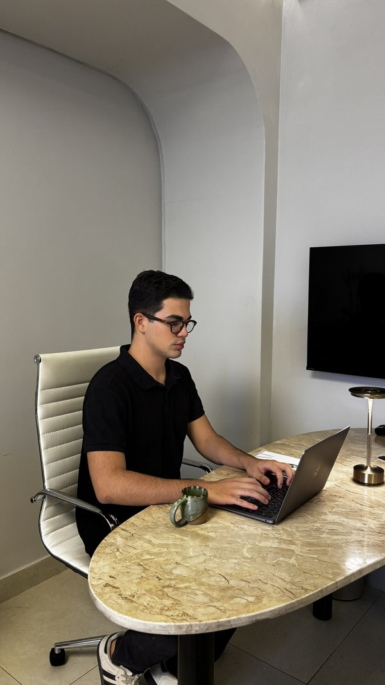
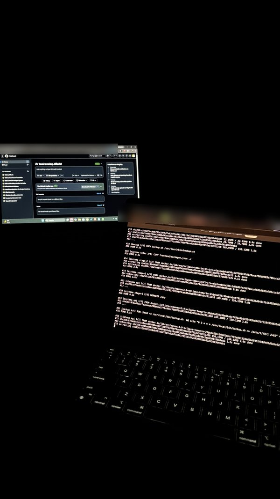

# Olá! Eu sou Flávio 👋

Sou formado em **Análise e Desenvolvimento de Sistemas**, moro em João Pessoa (PB) e estou em busca de oportunidades como Desenvolvedor de Software Júnior.

Tenho formação acadêmica em desenvolvimento de software, experiência com suporte de TI e estágio acadêmico em desenvolvimento Full Stack. Hoje desenvolvo sistemas para clientes reais: uma plataforma de gestão de flats de temporada e o design system, o site e o sistema de gestão de uma clínica de estética.

  
  

## 🚀 Projetos atuais

### [MyFlat](https://github.com/ttflavio/myflat)

Gestão de imóveis de temporada, em uso por uma administradora com 6 flats.

- Calendário único com reservas de todos os canais. O banco **impede overbooking** com constraint de exclusão do PostgreSQL, testada com 20 reservas simultâneas.
- Multi-tenant, login próprio com papéis e permissões e pendências por flat com IA (Claude API).
- Next.js 16, React 19, TypeScript, Prisma 7, PostgreSQL, Tailwind 4 e Vitest, com 58 testes.

### [Instituto Vivanti](https://github.com/ttflavio/vivanti)

Design system, site e sistema de gestão de uma clínica de estética.

- **Design system** em React + TypeScript com 46 componentes para Instagram e três marcas.
- **Site institucional** em React + Vite + Tailwind, pré-renderizado para SEO.
- **Sistema de gestão** em Java 21 + Spring Boot 3 + PostgreSQL: agenda, prontuário, financeiro, estoque e um robô de IA no WhatsApp. Roda em Docker num VPS.

## 🤖 IA generativa e automação

Estudo IA aplicando nos meus projetos: cada recurso de IA que construo resolve um problema real de um cliente e vai para produção com testes, controle de custo e revisão humana.

**IA dentro dos produtos (LLMs e Claude API)**
- **Saídas estruturadas:** no MyFlat, um texto livre ("chuveiro do 204 antes do próximo check-in; duas toalhas pro 319") vira tarefas validadas por um schema Zod. O servidor confere cada resultado, e o que a IA não tem certeza vai para triagem humana ([decisão documentada](https://github.com/ttflavio/myflat/blob/main/docs/adr/0005-pendencias-com-ia.md)).
- **Agente com ferramentas (tool use / function calling):** o robô de WhatsApp do Instituto Vivanti consulta horários livres reais na agenda, registra pré-reservas para a recepção confirmar e passa a conversa para a equipe quando precisa.
- **Uso responsável:** a IA fica desligada até ser habilitada, sempre há um caminho manual, os testes simulam a IA, as chaves ficam fora do código, e o sistema da clínica tem aceite LGPD e registro de quem acessa cada prontuário.

**Automação de processos**
- Integração com a WhatsApp Cloud API e o Instagram da Meta por webhooks, com aviso antes de o acesso vencer.
- CI/CD com GitHub Actions e deploy automático (Netlify, Docker num VPS), backup agendado do banco.
- Scripts que automatizam o trabalho repetitivo, como o que gera a versão pública destes repositórios e confere que nenhum dado de cliente vaza.

**Desenvolvimento assistido por IA**
- Uso o Claude Code no dia a dia, como par de programação: planejar arquitetura, escrever e revisar código, rodar testes e documentar decisões (ADRs).
- Crio skills e fluxos reutilizáveis para o agente, como o que planeja, escreve e gera carrosséis de Instagram.
- Engenharia de prompt e de contexto: as instruções do agente e do robô de WhatsApp ficam versionadas no repositório, junto com o código.

## 💻 Conhecimentos técnicos

**Programação e Desenvolvimento Web**
- TypeScript, JavaScript, React e Next.js
- Java e Spring Boot
- Python, PHP, HTML e CSS
- SQL, PostgreSQL e MySQL
- Prisma, Docker e GitHub Actions

**IA e Automação**
- LLMs e Claude API: saídas estruturadas, tool use e agentes
- Engenharia de prompt e desenvolvimento assistido por IA (Claude Code)
- WhatsApp Cloud API, webhooks e integrações com a Meta

**Análise de Dados**
- Pandas e Matplotlib
- Power BI

**Ferramentas e Tecnologias**
- Git e GitHub
- Visual Studio Code
- PostgreSQL e SQLite

**Experiência acadêmica complementar**

Ruby, Ruby on Rails, Sinatra, React, Angular, Node.js, APIs REST, Docker e Linux.

## 📌 Outros projetos

### [Sistema de Autorização por Saldo](https://github.com/ttflavio/autorizacao-lavanderia)

Projeto desenvolvido em Python para simular a autorização de serviços com base no saldo disponível.

- Validação de dados de entrada e regras de negócio.
- Lógica de autorização e recusa de operações.
- Testes de diferentes cenários para verificar os resultados esperados.

### [Raimundo's Madeiras](https://github.com/ttflavio/raimundos_artesanato)

Site desenvolvido com HTML e CSS para um negócio de produtos artesanais em madeira.

- Catálogo de produtos com imagens e preços.
- Navegação entre seções e layout responsivo.
- Links de contato pelo WhatsApp.

### [Film Review Website](https://github.com/ttflavio/meusite)

Projeto de desenvolvimento web utilizando PHP e HTML.

- Páginas de informações e avaliações de filmes.
- Estrutura de páginas reutilizáveis.
- Formulário de contato utilizando dados POST.

### [Workshop de Análise de Dados](https://github.com/ttflavio/Workshop.Analise-de-dados)

Exercícios práticos envolvendo Python, Pandas, Matplotlib, MySQL e Power BI.

- Análise exploratória e visualização de dados.
- Modelagem de banco de dados relacional.
- Criação de tabelas, chaves primárias e estrangeiras.

## 🎓 Formação e Experiência

- **Análise e Desenvolvimento de Sistemas** — Conclusão em janeiro de 2026.
- **Mediação de Tecnologia / Suporte de TI** — Experiência com suporte ao uso de tecnologias em ambiente educacional.
- **Estágio em Desenvolvimento Full Stack** — Experiência acadêmica com desenvolvimento de software.

## 🌱 Em desenvolvimento

Estou focado em fortalecer minha lógica de programação, aprimorar minhas habilidades em desenvolvimento backend, escrever códigos mais organizados e construir projetos que resolvam problemas reais.

Tenho interesse em engenharia de software, desenvolvimento backend e oportunidades de crescimento e colaboração em equipes de tecnologia.

## 📫 Contato

- **E-mail:** [ttflavio@icloud.com](mailto:ttflavio@icloud.com)
- **LinkedIn:** [flavio-netto](https://www.linkedin.com/in/flavio-netto)
- **GitHub:** [ttflavio](https://github.com/ttflavio)

## 🌍 Idiomas

- Português — Nativo
- Inglês — Avançado
